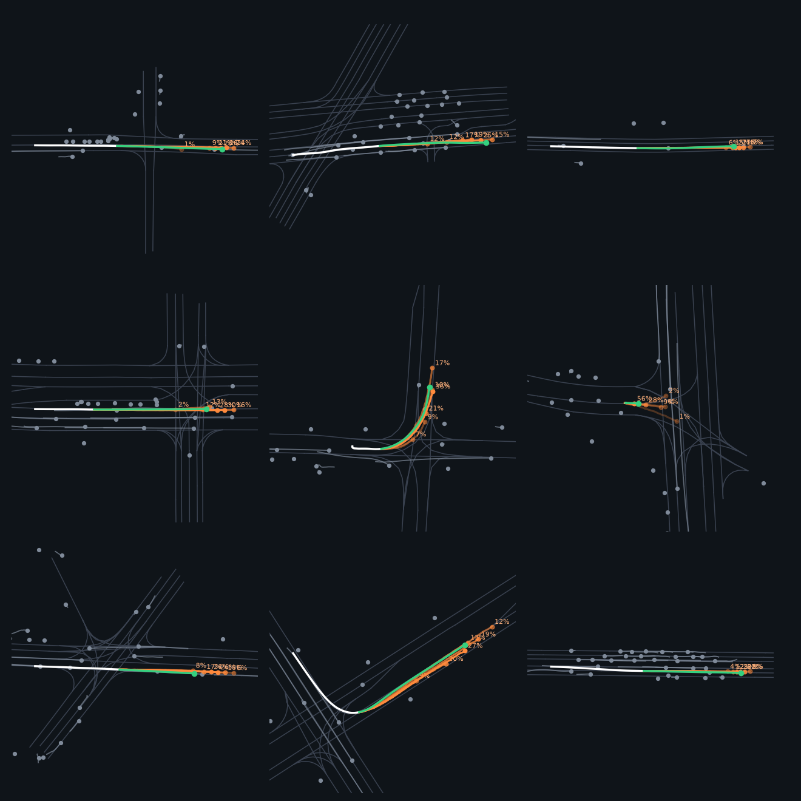
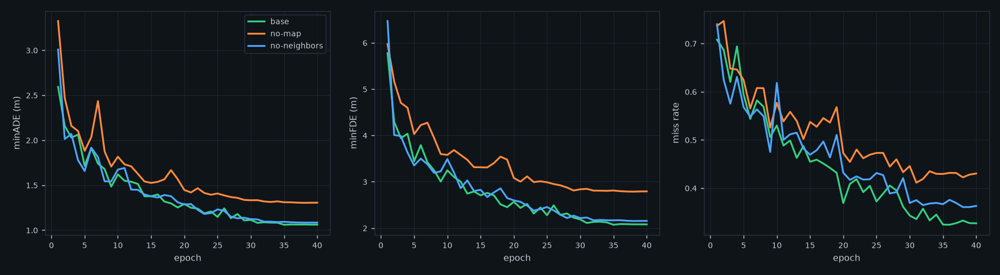
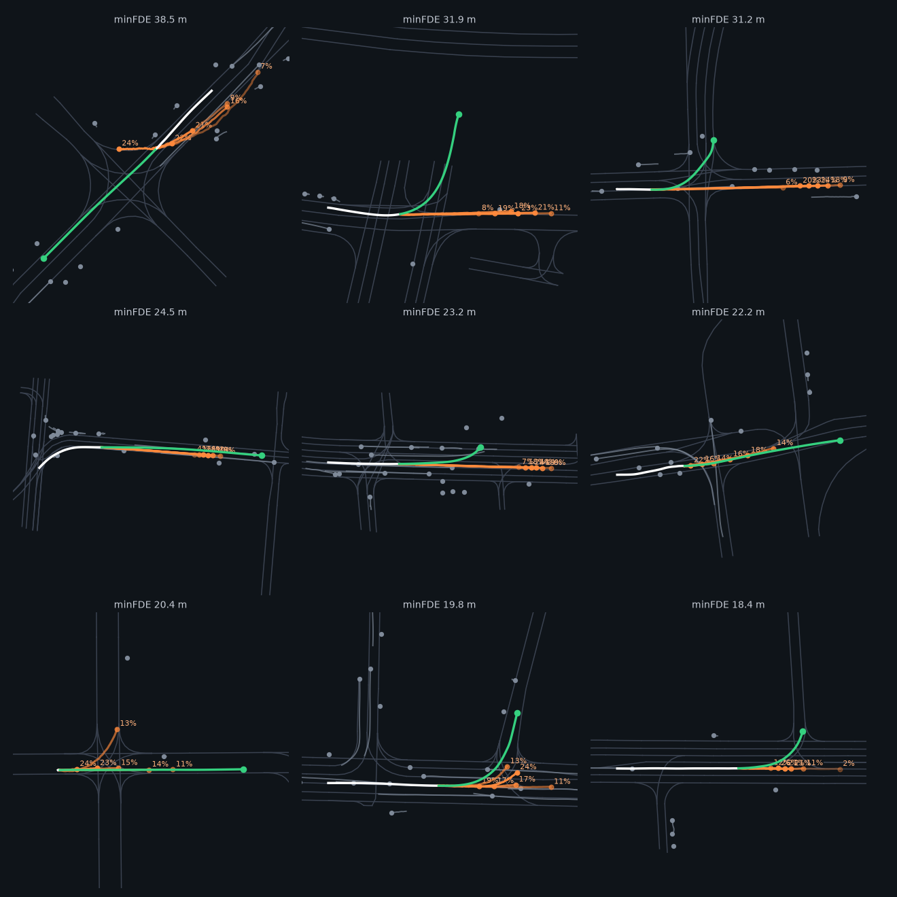
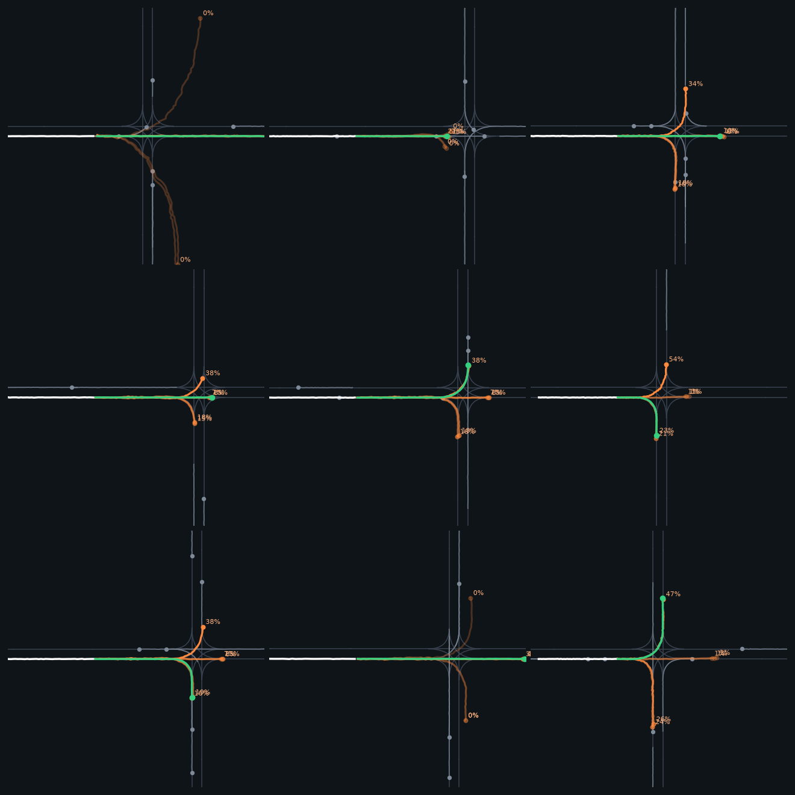

# SceneCast

Multimodal motion forecasting for driving scenes. Given 5 seconds of history for
every agent in a scene plus the lane map, SceneCast predicts 6 candidate
trajectories for the next 6 seconds of a focal agent, each with a confidence.

It is a compact (about 1.6M parameter) vectorized scene transformer written from
scratch in PyTorch, trained and evaluated on the
[Argoverse 2 Motion Forecasting](https://www.argoverse.org/av2.html) dataset. It
trains on a laptop GPU (Apple Silicon MPS) or a single CUDA GPU.



White is the observed 5 s history, green the true future, orange the six
predicted futures with their confidences. Grey is the lane map and other agents.

| Argoverse 2 validation | minADE | minFDE | Miss rate |
|---|---|---|---|
| Constant velocity | 4.75 m | 12.25 m | 0.87 |
| **SceneCast** | **1.06 m** | **2.07 m** | **0.32** |

## How it works

```
agent tracks  [32 x 50 steps] --> polyline encoder --+
                                                     +--> scene transformer --> 6 mode queries --> 6 trajectories
lane centerlines [96 x 10 pts] --> polyline encoder --+        (4 layers)        (2-layer decoder)   + confidences
```

1. **Focal-centric input.** Every scene is translated and rotated so the focal
   agent sits at the origin facing +x at the prediction time. The model never has
   to learn rotation invariance.
2. **Polyline tokens.** Each agent track and each lane centerline is a polyline.
   A small PointNet-style encoder (point MLP, max-pool, concat, MLP, max-pool)
   turns each one into a single token, in the spirit of VectorNet.
3. **Scene transformer.** Agent and lane tokens attend to each other, so the focal
   agent's token absorbs who is around it and where the road goes.
4. **Mode queries.** Six learned queries cross-attend to the scene and each
   decodes one future as per-step displacements, plus a confidence logit.
5. **Winner-takes-all loss.** Only the mode closest to the ground truth is
   regressed (smooth L1), and a cross-entropy term teaches the confidence head to
   pick that mode. This is what stops the modes collapsing to their average.

## Results

Trained on 20,000 scenarios (10% of the Argoverse 2 training set) for 40 epochs,
about 2.5 hours on an Apple M4 laptop. Evaluated on 3,000 validation scenarios,
6 modes, 6 second horizon. Lower is better everywhere.

| Model | minADE | minFDE | Miss rate | brier-minFDE | minFDE (top-1) |
|---|---|---|---|---|---|
| Constant velocity (1 mode) | 4.75 | 12.25 | 0.87 | 12.25 | 12.25 |
| **SceneCast** | **1.06** | **2.07** | **0.32** | **2.71** | **6.65** |
| SceneCast, no map | 1.30 | 2.79 | 0.42 | 3.41 | 7.86 |
| SceneCast, no neighbours | 1.08 | 2.15 | 0.36 | 2.78 | 7.34 |

- **minADE / minFDE**: average / final displacement error in metres of the best of the 6 modes.
- **Miss rate**: fraction of scenes where the best mode ends more than 2 m from the truth.
- **brier-minFDE**: minFDE plus a penalty for giving the best mode low confidence.
- **minFDE (top-1)**: final error of the single mode the model is most confident in.

Raw numbers are in [`results/av2_val.json`](results/av2_val.json).



**What the ablations say**

- **The map matters most.** Hiding the lane tokens raises minFDE by 35% (2.07 to
  2.79 m) and the miss rate from 0.32 to 0.42. The gap opens in the first few
  epochs and never closes.
- **Other agents matter much less for best-of-6 error**, only 4% on minFDE. They
  help more with choosing among the modes: miss rate goes from 0.32 to 0.36 and
  top-1 minFDE from 6.65 to 7.34 m without them. Knowing what the cars around you
  are doing seems to help more with *which* future is likely than with *what* the
  candidate futures are.
- **Confidence is the weak point.** The best of six modes ends 2.07 m from the
  truth, but the mode the model ranks first ends 6.65 m away.

**Caveats.** These are single runs with one seed, so small differences (the
neighbour ablation in particular) are suggestive rather than established. The
checkpoint for each run was selected on the same validation scenarios it is
reported on. The numbers are not comparable with the public leaderboard, which
uses the full validation and test sets; for orientation, leading published
methods trained on all 200,000 scenarios report minFDE of roughly 1.2 to 1.4 m.

## Failure analysis

The nine validation scenes with the highest final error
(`python -m scenecast.viz ... --worst`):



Three patterns account for almost all of them:

1. **Missed turns.** In six of the nine, the agent turns and every one of the
   six modes goes straight. The modes spread out along the direction of travel
   (different speeds) rather than across manoeuvres, so a turn that the history
   does not hint at is not covered at all. Winner-takes-all training only rewards
   the closest mode, and with most training futures being roughly straight, the
   queries specialise in speed rather than in direction.
2. **Wrong speed profile.** In two scenes the path is right but the agent
   accelerates far more than any mode predicts (for example pulling away after a
   turn), leaving the best mode 20 m or more short.
3. **Wrong direction of travel.** In the worst scene the predictions run opposite
   to the true future. I have not confirmed the cause; a heading that is
   unreliable at low speed is one candidate.

The most direct fix for the first pattern is to anchor the modes to the map:
propose candidate goal points along reachable lanes and decode one trajectory per
goal, instead of relying on free-form learned queries.

## A bug worth remembering: modes that only differ by dropout

The first version looked fine in training and fell apart in evaluation: on the
synthetic intersection data, minFDE was about 1.0 m with the model in train mode
and about 10 m in eval mode, with all six modes drawn on top of each other.

The cause was the decoder. The mode queries were initialised almost identically
(std 0.02) and the decoder used dropout, so during training the six outputs
differed mainly through dropout noise. Winner-takes-all training happily used
that noise as its source of diversity. With dropout off at eval time, the modes
collapsed into one. Initialising the queries at unit scale and removing dropout
from the decoder fixed it:

| Synthetic intersections (800 val scenes) | minADE | minFDE | Miss rate |
|---|---|---|---|
| Constant velocity | 3.35 | 12.05 | 0.83 |
| SceneCast, before the fix | 2.90 | 9.82 | 0.61 |
| SceneCast, after the fix | 0.21 | 0.38 | 0.02 |



White is the observed history, green the true future, orange the six predicted
modes with their confidences. These are synthetic scenes used as a pipeline
check, not a benchmark result.

## Quick start

```bash
uv venv --python 3.12 && uv pip install -e ".[dev]"
source .venv/bin/activate
pytest
```

### Smoke test without downloading anything

A synthetic four-way intersection generator exercises the whole pipeline. The
focal car turns left, goes straight or turns right, so the task is multimodal.

```bash
python -m scenecast.data.synthetic --out data/processed/synth
python -m scenecast.train --data data/processed/synth --name synth --epochs 20 --warmup-steps 100
python -m scenecast.evaluate --data data/processed/synth/val --ckpt runs/synth/best.pt
python -m scenecast.viz --data data/processed/synth/val --ckpt runs/synth/best.pt --out assets/synth.png
```

### Argoverse 2

The dataset is public and needs no sign-up. A scenario is about 250 KB, so
20,000 training scenarios is roughly 5 GB.

```bash
python scripts/download_av2.py --split train --num 20000
python scripts/download_av2.py --split val --num 3000

python -m scenecast.data.av2 --raw data/raw/av2/train --out data/processed/av2/train
python -m scenecast.data.av2 --raw data/raw/av2/val --out data/processed/av2/val

python -m scenecast.train --data data/processed/av2 --name base --epochs 30
```

Ablations reuse the same command with one flag each:

```bash
python -m scenecast.train --data data/processed/av2 --name no-map --no-map
python -m scenecast.train --data data/processed/av2 --name no-neighbors --no-neighbors
```

Evaluate everything in one table, then render figures:

```bash
python -m scenecast.evaluate --data data/processed/av2/val --ckpt runs/base/best.pt runs/no-map/best.pt runs/no-neighbors/best.pt
python -m scenecast.viz --data data/processed/av2/val --ckpt runs/base/best.pt --out assets/grid.png
python -m scenecast.viz --data data/processed/av2/val --ckpt runs/base/best.pt --out assets/demo.gif --index 12

# failure analysis: the nine scenes with the highest final error
python -m scenecast.viz --data data/processed/av2/val --ckpt runs/base/best.pt --out assets/failures.png --worst
python -m scenecast.curves --runs runs/base runs/no-map runs/no-neighbors --out assets/curves.png
```

## Repository layout

| Path | What it does |
|---|---|
| `src/scenecast/data/scene.py` | Scene format, focal-frame normalization, fixed-size sample building |
| `src/scenecast/data/av2.py` | Argoverse 2 parser (pandas only, no `av2` dependency) |
| `src/scenecast/data/synthetic.py` | Synthetic intersection scenes |
| `src/scenecast/data/store.py` | Memory-mapped on-disk splits and the PyTorch dataset |
| `src/scenecast/model.py` | Polyline encoders, scene transformer, mode-query decoder |
| `src/scenecast/metrics.py` | Winner-takes-all loss, metrics, constant-velocity baseline |
| `src/scenecast/train.py`, `evaluate.py`, `viz.py`, `curves.py` | Training loop, evaluation table, figures, validation curves |
| `scripts/download_av2.py` | Subset downloader for the public Argoverse 2 bucket |

## Limitations and next steps

- The six modes differ mostly in speed, not manoeuvre, so unsignalled turns are often missed (see the failure analysis).
- Predicts one focal agent per scene (marginal prediction), not joint futures for interacting agents.
- Uses lane centerlines only: no crosswalks, lane boundaries or traffic-light state.
- No data augmentation or ensembling; a larger model and the full 200k training scenarios should close part of the gap to published methods.
- Port the data pipeline to the Waymo Open Motion Dataset, which adds traffic-light state and an 8 second horizon.

## References

- Gao et al., *VectorNet: Encoding HD Maps and Agent Dynamics from Vectorized Representation*, CVPR 2020
- Wilson et al., *Argoverse 2: Next Generation Datasets for Self-Driving Perception and Forecasting*, NeurIPS Datasets 2021
- Ettinger et al., *Large Scale Interactive Motion Forecasting for Autonomous Driving: The Waymo Open Motion Dataset*, ICCV 2021
